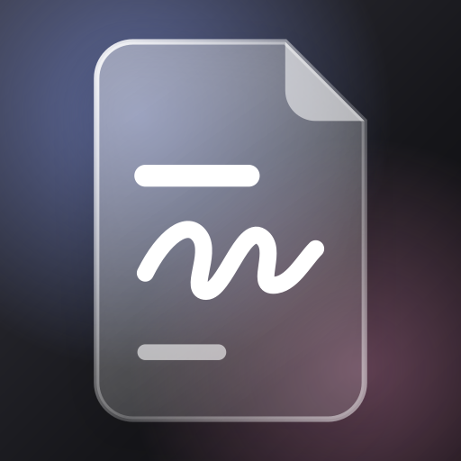
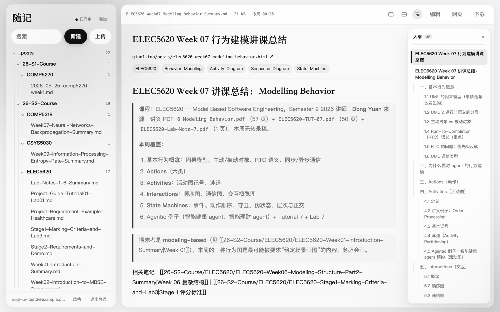
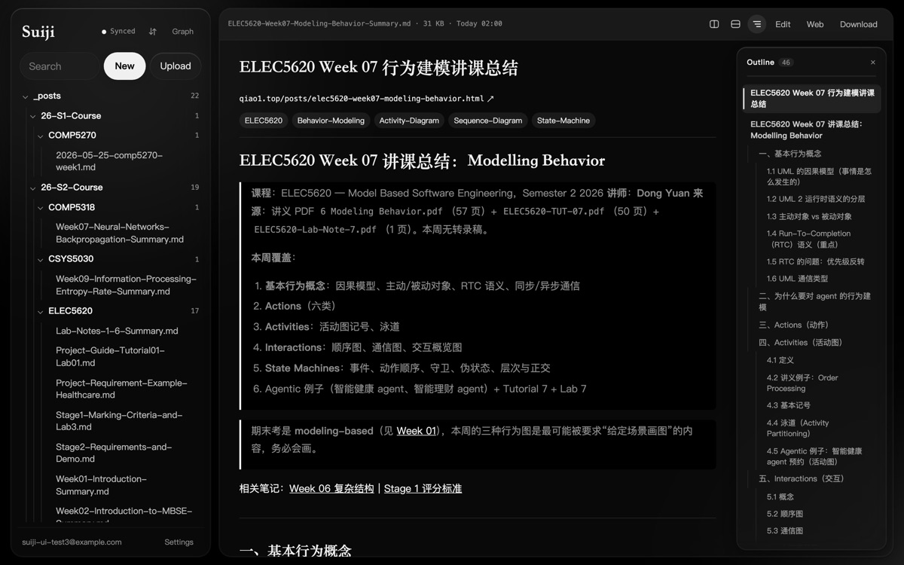
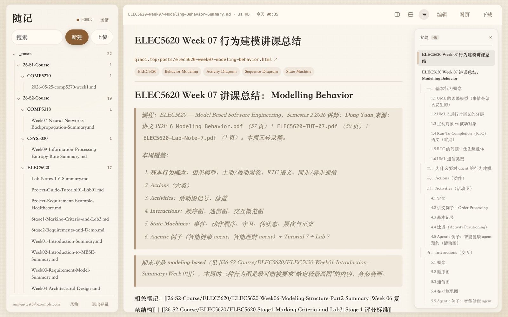
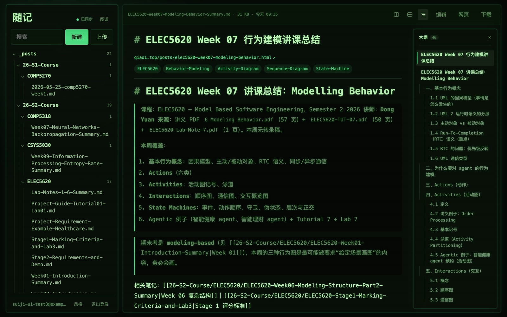
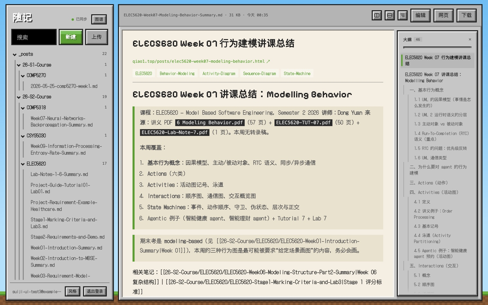
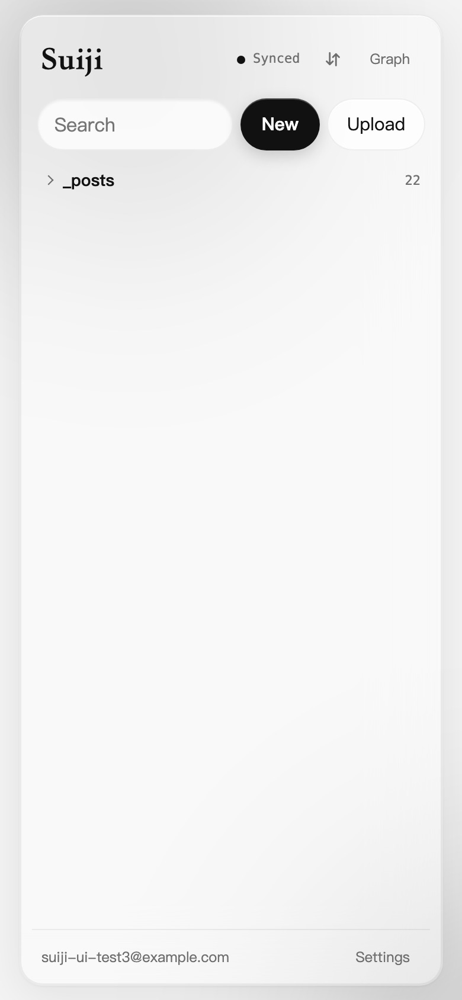
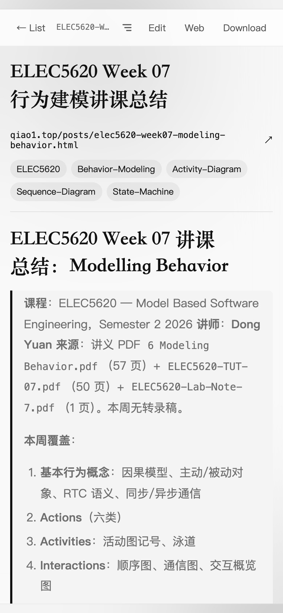

<div align="center">



# Suiji 随记

**Notes that sync between iPhone and Mac, with your Markdown folder on both**

[](README.md)
[](README.zh-CN.md)

[](https://suiji-notes.vercel.app)




&nbsp;&nbsp;&nbsp;

&nbsp;&nbsp;

</div>

## Features

- **One tree.** Quick notes written in the app sit in a 「随手记」 folder at the top, and the synced folders sit below it.
- **Edit anywhere.** Edit a file on the phone, and the Mac agent writes it back to disk within a few seconds.
- **Outline.** Every document has its own outline beside it: click a heading to jump, and the current section stays marked as you scroll. Drag its edge to resize it.
- **Split panes.** Split up, down, left or right, by dragging a file onto a pane's edge or with ⌘-click. The layout is remembered.
- **Styles.** Four looks, picked in 设置 (Settings):
  - 玻璃 *Glass*: follows the system's light / dark
  - 纸张 *Paper*: warm paper and serif text
  - 终端 *Terminal*: green on black, monospace
  - 方块 *Blocks*: a pixel-art world of sky, grass and stone panels

  The tab icon, and the Mac app's Dock icon, change with the style.
- **Settings.** 设置 at the bottom of the sidebar holds the style, text size, whether new documents show their outline, widths, sync, the local cache, the account and update checks.
- **Relationship graph.** Like Obsidian's graph, built from `[[wikilinks]]`, relative `.md` links and front-matter tags.
- **Markdown.** Math (KaTeX), Mermaid diagrams, and Obsidian's `[[wikilinks]]` (shown by their alias, opening the linked note) and `==highlights==`.
- **Blog links.** Every published post links to its page on the blog (`https://qiao1.top/posts/<abbrlink>.html`).
- **Fast and offline-first.** Documents are cached on the device and prefetched. Notes save on the device first and upload once online.
- **Always current.** Open windows pick up a new deploy by themselves, and the Mac app updates itself.

## Install

- **iPhone:** open <https://suiji-notes.vercel.app> in Safari, tap Share, then 添加到主屏幕 (Add to Home Screen).
- **Mac app:** build it with `./mac/build.sh --install` (see [Build from source](#build-from-source)). Without the app, Safari's File → Add to Dock works too.
- **Sync a folder from the Mac:**

  ```sh
  npm run sync login       # sign in to your Suiji account
  npm run sync add         # choose a folder; it uploads right away
  npm run sync install     # run in the background whenever you log in
  ```

  `npm run sync status` shows the account, folders and file counts. `npm run sync remove ~/some/folder` stops syncing a folder; the cloud copies stay. `npm run sync uninstall` stops the background job.

## Build from source

### Web app

```sh
npx vercel link --yes --project suiji-notes
npx vercel integration add supabase --yes --no-claim
npx vercel env pull .env.local --yes
npm install
npm run db:setup        # creates the tables, policies and storage bucket from schema.sql
npm run dev             # serves the app on port 5173
npx vercel deploy --prod
```

### Mac app

Requires the Xcode Command Line Tools.

```sh
./mac/build.sh             # builds mac/build/随记.app (universal, ad-hoc signed)
./mac/build.sh --install   # also copies it to /Applications
./mac/build.sh --publish   # writes public/mac/Suiji.zip and version.json for the next deploy
```

To release a new build: raise `BUILD` in `mac/build.sh`, run it with `--publish`, then deploy.

## How it works

| Part | Where | What it does |
|---|---|---|
| Web app | `public/` | Plain HTML/JS, no framework, hosted on Vercel |
| Data | Supabase | Postgres tables `notes` and `files`, a private storage bucket, and Realtime. Row-level security means each user sees only their own data. |
| Folder agent | `agent/suiji-sync.mjs` | Node script run by launchd on the Mac. It watches the synced folders. |
| Mac app | `mac/` | Native AppKit window around the web app, plus a menu bar item for the agent |

**Notes** are saved on the device, then upserted to `notes`. Other devices receive changes through Realtime. If two devices edit the same note, the last save wins.

**Folder files** sync in both directions:

- **Mac → cloud:** the agent watches the folder. New and changed files are uploaded, and deleted files are removed from the cloud. A full rescan every 5 minutes catches anything a watch event missed.
- **Phone → Mac:** an edit saved in the app updates the file's row. The agent hears about it through Realtime and writes the new version to disk.
- **Conflicts:** if both sides changed a file since the last sync, the local file is kept and uploaded. The cloud version is saved beside it as 「（随记副本）」.

## Notes

- The Mac window loads the live site, so web changes arrive with every deploy. An open window checks for a new deploy every 10 minutes and when it comes to the front. It reloads by itself when nothing is being edited, and otherwise shows a 「有新版本」 button.
- The Mac app checks `mac/version.json` on the site at launch and every 6 hours. A newer build downloads in the background, is verified, then installs on restart or on quit.
- The menu bar item shows whether the folder agent is running, and has 立即同步 (sync now), the synced folder and the sync log. Links to other sites open in your default browser, and downloads go to `~/Downloads`.
- The folder agent skips hidden files, `node_modules` and `.git`, and does not upload files over 50 MB. Settings, state and the log live in `~/.suiji/`; the log is `~/.suiji/sync.log`.
- Storage can serve the previous copy of a file for a while after an upload, through a URL signed earlier. So reads use freshly signed URLs and must match the size in the row.
- Styles are saved per device. 方块 loads two pixel fonts from Google Fonts, and only when it is picked.
