<div align="center">

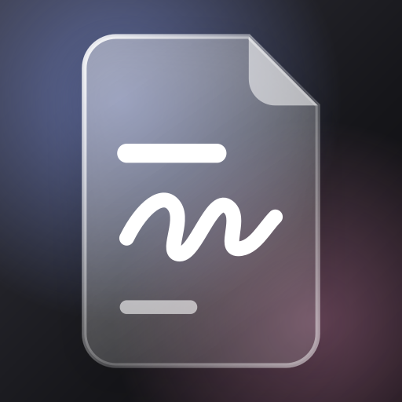

# 随记

**在 iPhone 和 Mac 之间同步的笔记，你的 Markdown 文件夹两边都能看、能改**

[](README.md)
[](README.zh-CN.md)

[](https://suiji-notes.vercel.app)


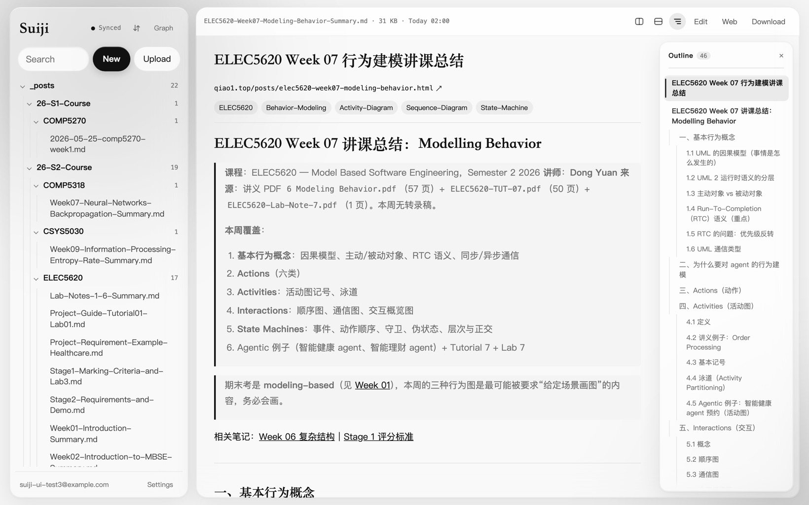

&nbsp;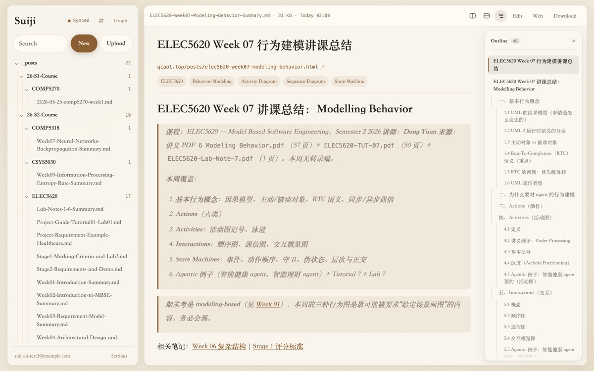&nbsp;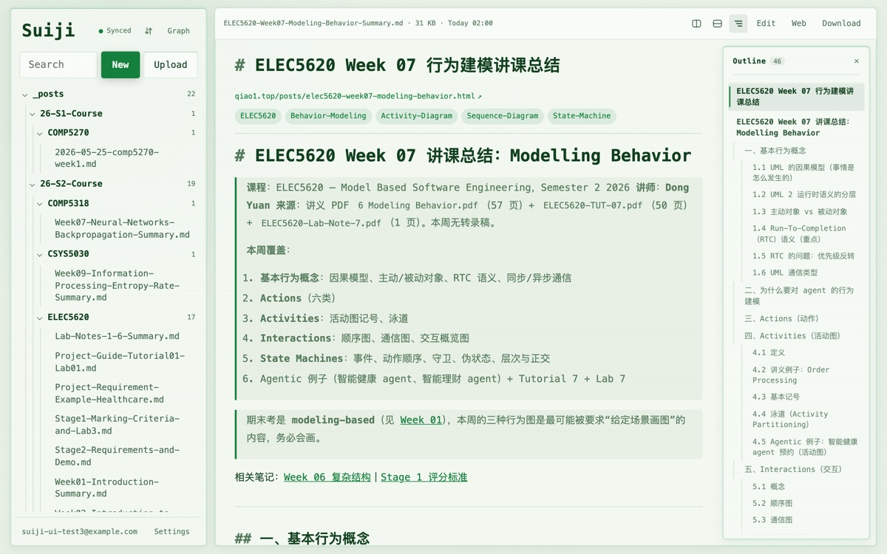&nbsp;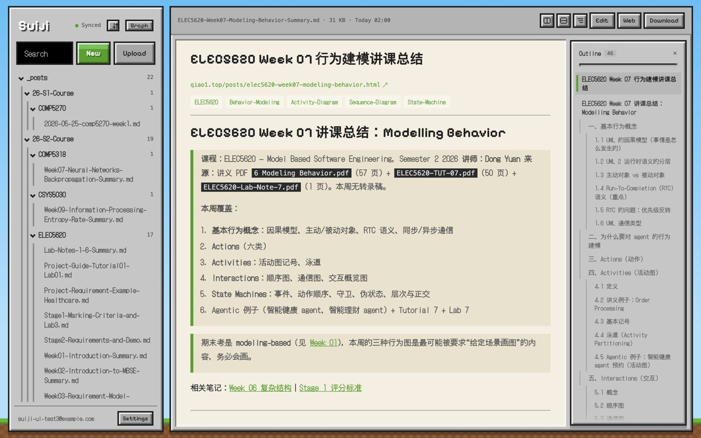

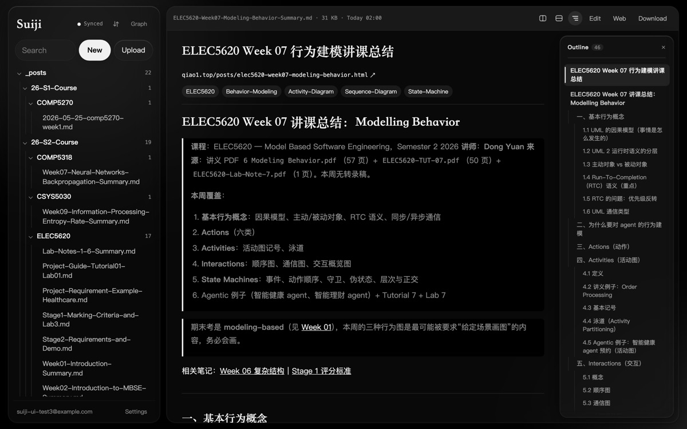&nbsp;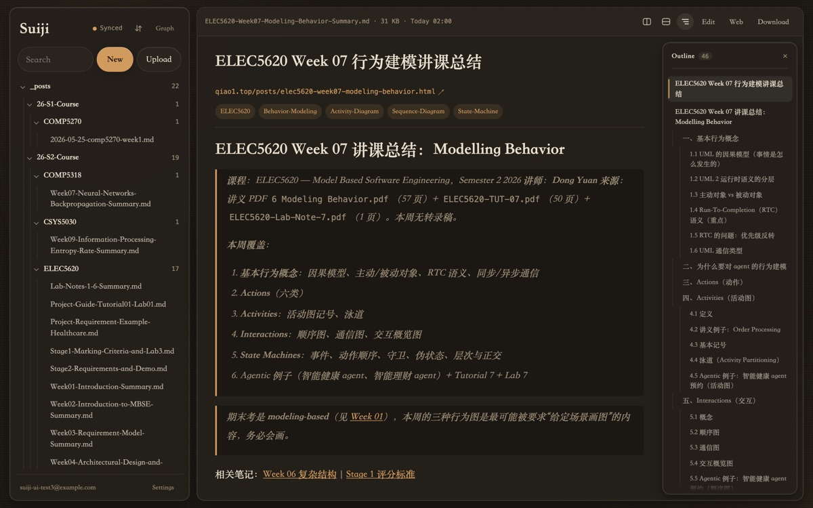&nbsp;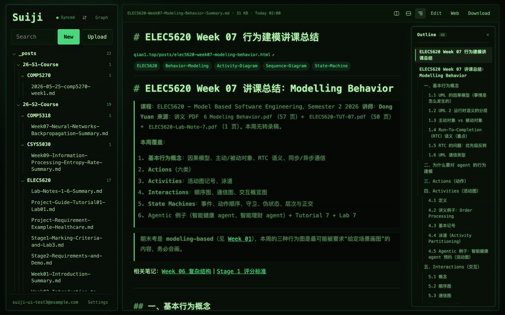&nbsp;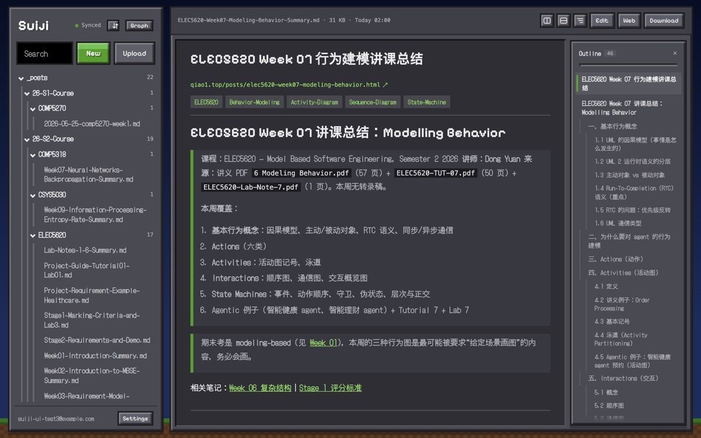

<sub>玻璃、纸张、终端、方块，上排浅色，下排深色</sub>

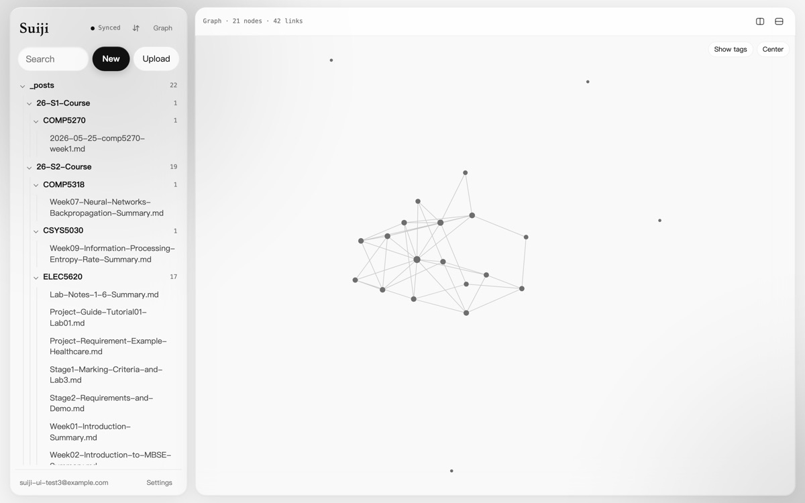&nbsp;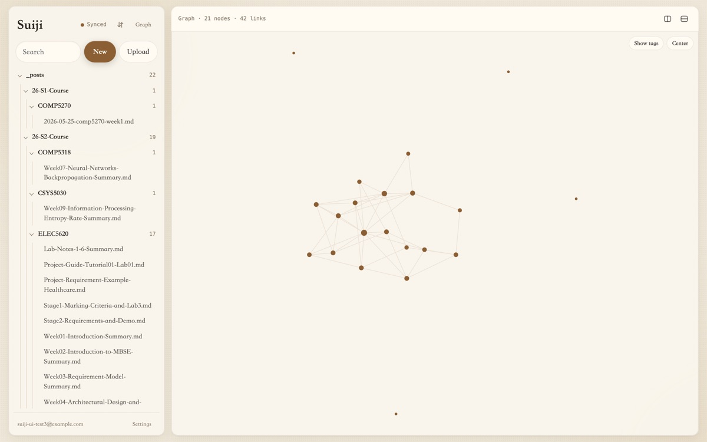&nbsp;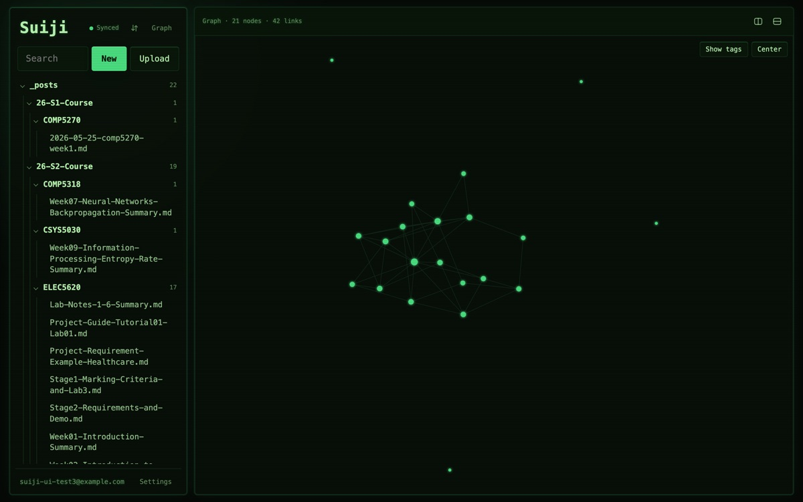&nbsp;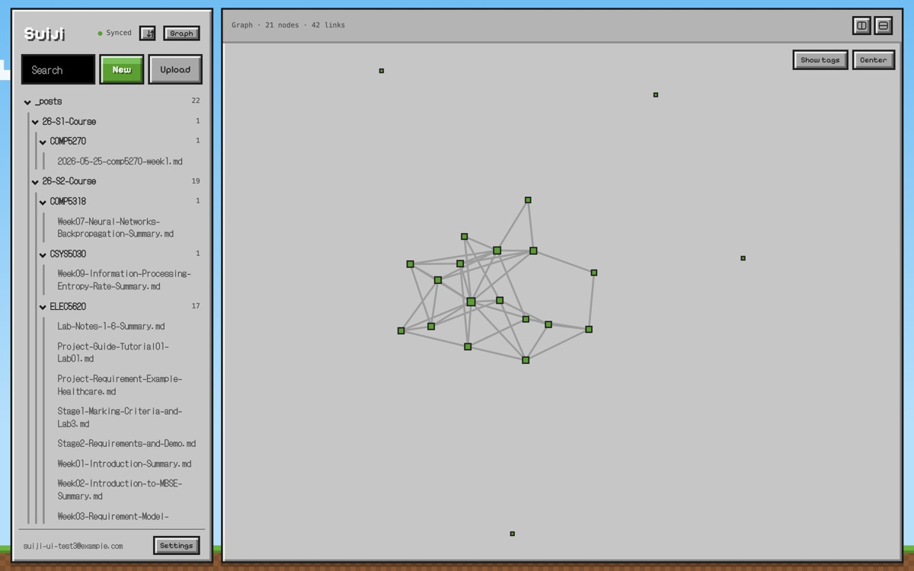

<sub>各风格下的关系图谱</sub>

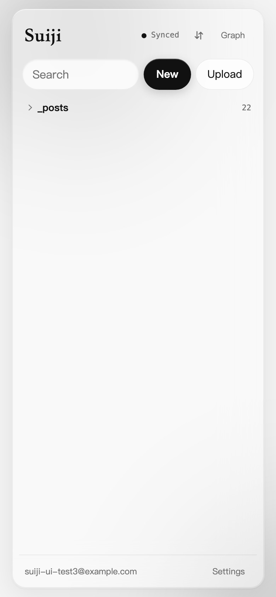&nbsp;&nbsp;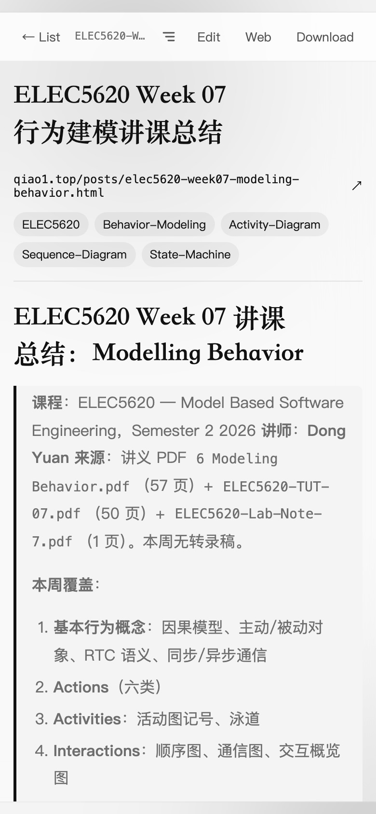&nbsp;&nbsp;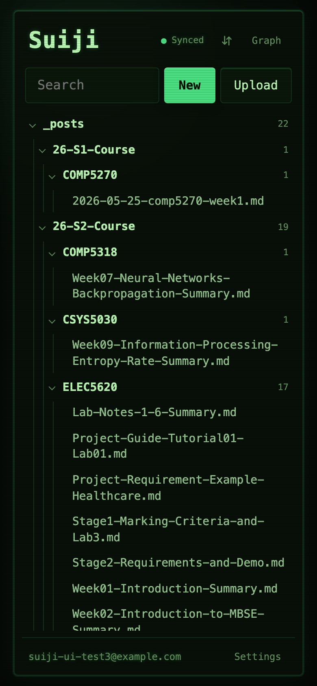

</div>

## 功能

- **一棵目录树：**在 App 里写的随手记放在最上面的「随手记」文件夹，同步过来的文件夹排在下面。点 ⇅ 可以按名称或按修改时间排列。
- **Mac 上直接用本地文件夹：**像 Obsidian 的库一样，Mac App 直接读写磁盘上的文件夹，文档秒开，离线也能用。在 App 里或其他编辑器里的改动会同步到云端，手机上的修改几秒后写回磁盘。
- **大纲：**每个文档旁边都有自己的大纲。点击标题就能跳过去，滚动时会标出当前所在的小节。拖动边缘可以调宽度。
- **分屏：**可以上下左右分屏。把文件拖到窗格边缘，或者按住 ⌘ 点击文件即可。布局会被记住。
- **风格：**在「设置」里选，一共十二种，每种都有浅色和深色（跟随系统，也可以手动选）：
  - 玻璃：通透的毛玻璃
  - 纸张：暖色纸面，衬线字；深色是灯下的旧纸
  - 终端：黑底绿字，等宽；浅色是浅底深绿字
  - 方块：像素方块世界，有天空、草地和石头面板；深色是夜晚，有月亮
  - 水墨：宣纸、浓淡墨色和朱红印章
  - 墨水屏：只有黑白灰，没有动画和半透明
  - 手帐：点阵纸、纸胶带和荧光笔
  - 瑞士：严格的网格、粗体无衬线字和一点红
  - 霓虹：夜里品红和青色的发光招牌；浅色是白天
  - 蓝图：工程蓝底上的白线和坐标网格
  - 粘土：柔和的马卡龙色和鼓起来的圆角卡片
  - 日落：暖橙到紫的天空；深色是黄昏后的星空

  浏览器标签页的图标、Mac App 的 Dock 图标、安卓桌面图标和关系图谱都会跟着风格变。
- **设置：**侧边栏底部的「设置」里有风格、明暗、正文字号、界面语言（中文 / English）、新文档是否显示大纲、宽度、同步、本机缓存、账号和检查更新。
- **助手：**点 ✦ 按钮（或按 ⌘J）在右侧打开对话面板，手机上从底部弹出。可以让它查找、总结或修改笔记：它会在 App 里搜索和阅读你的笔记，每处改动都先以对比的形式给你看，按「应用」之前什么都不会改。用的是你自己的 API key，支持任何 OpenAI 兼容服务（DeepSeek、OpenRouter、Kimi、智谱 GLM、通义千问、OpenAI，或自定义地址），在「设置 → 助手」里填。key 加密保存在你的账号里，每台设备都能用。
- **关系图谱：**类似 Obsidian 的图谱，根据 `[[双链]]`、相对 `.md` 链接和 front matter 里的标签生成。
- **Markdown：**支持数学公式（KaTeX）、Mermaid 图，以及 Obsidian 的 `[[双链]]`（显示别名，点击打开对应笔记）和 `==高亮==`。
- **博客链接：**每篇已发布的文章都链接到它在博客上的页面（`https://qiao1.top/posts/<abbrlink>.html`）。
- **快，离线优先：**文档缓存在本机，还会提前下载。笔记先存在本机，联网后再上传。
- **总是最新：**打开着的窗口会自己用上新部署的版本，Mac App 也会自动更新。

## 安装

- **iPhone：**用 Safari 打开 <https://suiji-notes.vercel.app>，点分享按钮，再点「添加到主屏幕」。
- **安卓：**在手机上下载 [`Suiji.apk`](https://suiji-notes.vercel.app/android/Suiji.apk) 并打开（按提示允许从浏览器安装应用）。
- **Mac App：**运行 `./mac/build.sh --install` 生成（见[从源码构建](#从源码构建)）。不装 App 的话，在 Safari 里选「文件 → 添加到程序坞」也可以。
- **在 Mac 上同步一个文件夹：**在 Mac App 里打开「设置 → 本地文件夹 → 添加文件夹…」。App 运行时（包括只剩菜单栏图标时）持续同步，菜单栏里可以勾选「登录时打开」。

  不用 App 的话，也可以在终端里用 Node 同步程序：

  ```sh
  npm run sync login       # 登录随记账号
  npm run sync add         # 选择文件夹，立即上传
  npm run sync install     # 设为登录 Mac 后自动在后台运行
  ```

  `npm run sync status` 查看账号、文件夹和文件数。`npm run sync remove ~/某个文件夹` 停止同步这个文件夹，云端文件保留。`npm run sync uninstall` 取消后台运行。两者共用 `~/.suiji/` 里的文件夹列表和同步状态，所以 App 会原样接管同步程序的文件夹；App 启动时会停掉同步程序的后台任务，免得两边同步同一个文件夹。

## 从源码构建

### 网页 App

```sh
npx vercel link --yes --project suiji-notes
npx vercel integration add supabase --yes --no-claim
npx vercel env pull .env.local --yes
npm install
npm run db:setup        # 根据 schema.sql 建表、设置权限和存储桶
npm run dev             # 在本地 5173 端口运行
npx vercel deploy --prod
```

助手需要 `AI_KEY_SECRET`（随便一串足够长的随机字符），用来加密用户保存的 key。可选：设了 `DEEPSEEK_API_KEY` 和 `AGENT_OWNER_EMAILS`（用逗号分隔）后，这些账号没填自己的 key 时会用服务器上的 DeepSeek key；`DEEPSEEK_MODEL` 选它的模型（默认 `deepseek-flash`）。改了 `AI_KEY_SECRET` 之后，已保存的 key 就解不开了，用户需要重新填。

### Mac App

需要 Xcode 命令行工具。

```sh
./mac/build.sh             # 生成 mac/build/随记.app（通用二进制，本地签名）
./mac/build.sh --install   # 同时复制到「应用程序」文件夹
./mac/build.sh --publish   # 生成 public/mac/Suiji.zip 和 version.json，随下次部署发布
```

发布新版本：把 `mac/build.sh` 里的 `BUILD` 加一，带 `--publish` 运行，再部署。

### 安卓 App

需要 JDK 17 以上和 Android SDK（平台 35、build tools），例如 `brew install --cask android-commandlinetools`。

```sh
./android/build.sh             # 生成签名的 android/build/Suiji.apk
./android/build.sh --publish   # 同时复制到 public/android/Suiji.apk，随下次部署发布
```

第一次运行会生成签名密钥 `android/suiji-release.keystore`，密码在 `android/keystore.properties`。两个文件都不进 git，请另外备份：只有用同一把密钥签名，新版本才能覆盖安装旧版本。每次发布前把 `android/app/build.gradle.kts` 里的 `versionCode` 加一。调试版（`./gradlew assembleDebug`）改为打开 `http://localhost:5174/`，配合 `adb reverse tcp:5174 tcp:5174` 使用。

## 工作原理

| 部分 | 位置 | 作用 |
|---|---|---|
| 网页 App | `public/` | 纯 HTML/JS，不用框架，部署在 Vercel |
| 数据 | Supabase | Postgres 表 `notes` 和 `files`、私有存储桶和 Realtime。行级安全保证每个人只能看到自己的数据。 |
| 助手 | `public/agent.js`、`api/agent.js`、`api/ai-key.js` | 工具（搜索、阅读、提出修改）在页面里对已有的笔记运行；Vercel 函数验证 Supabase 登录，再用用户自己的 OpenAI 兼容接口流式返回模型的下一步。key 加密存在 `ai_keys` 表里，只有服务器能读 |
| 文件夹同步 | `public/syncengine.js` | 把本地文件夹和云端同步。Mac App 在页面里运行它（`public/localsync.js`），通过只能访问所选文件夹的文件桥（`mac/LocalFiles.swift`）；没有 App 时由 Node 同步程序 `agent/suiji-sync.mjs` 运行 |
| Mac App | `mac/` | 用原生 AppKit 窗口装着网页 App，能访问本地文件夹，外加一个显示同步状态的菜单栏图标 |
| 安卓 App | `android/` | 用 WebView 装着网页 App，支持返回键、选文件、下载，桌面图标跟随风格 |

**随手记**先存在本机，再写入 `notes` 表，其他设备通过 Realtime 实时收到改动。两台设备改同一条笔记时，以最后保存的为准。

**文件夹里的文件**双向同步：

- **Mac → 云端：**Mac App（或同步程序）监听文件夹，新增和修改的文件会上传，本地删除的文件云端也会删除。另外每 5 分钟完整检查一遍，补上漏掉的改动。
- **手机 → Mac：**在其他设备上保存的修改会更新这个文件的记录，Mac 通过 Realtime 收到通知后，把新版本写回本地。在 Mac App 里改的文件先存到磁盘，再从磁盘上传。
- **冲突：**如果上次同步后两边都改了同一个文件，保留并上传本地版本，云端版本另存为「（随记副本）」。

## 说明

- Mac 窗口里加载的是线上网站，所以网页的改动每次部署后就会生效。打开着的窗口每 10 分钟、以及切回前台时检查一次有没有新部署：没有在编辑就自动刷新，否则显示「有新版本」按钮。
- Mac App 会在启动时和每 6 小时检查网站上的 `mac/version.json`，有更新的版本就在后台下载并校验，重启或退出时安装。
- 菜单栏图标显示同步状态，还有「立即同步」、「打开同步的文件夹」、「查看同步日志」和「登录时打开」。关掉窗口同步也会继续，要退出就用菜单栏图标或 ⌘Q。指向其他网站的链接会用默认浏览器打开，下载的文件存到「下载」文件夹。
- 文件夹同步会跳过隐藏文件、符号链接、`node_modules` 和 `.git`，超过 50 MB 的文件不上传。配置、状态和日志都在 `~/.suiji/`，日志是 `~/.suiji/sync.log`。
- 上传后，用之前签发的链接去读，存储可能还会返回旧内容一段时间。所以读取时用新签发的链接，并核对文件大小是否和记录一致。
- 界面有中文和英文（设置 → 语言，默认跟随系统），Mac App 的菜单也会跟着变。
- 风格、明暗和排序方式按设备分别保存。选「方块」时才会从 Google Fonts 加载两款像素字体。
